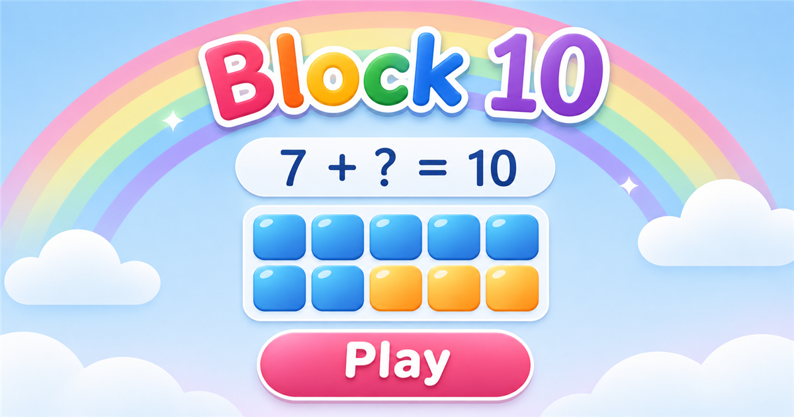

# Block 10

[English](README.md) | [日本語](README.ja.md)

Block 10 is an addition and subtraction game that helps kids build number skills through play.

**[Play Block 10](https://akiplaylab.github.io/block10/)**

## Documentation

- [Educational philosophy](docs/Philosophy.md)
- [User guide](docs/UserGuide.md)
- [Specification (Japanese)](docs/Specification.md)
- [Development guide (Japanese)](docs/Development.md)

## License

Block10 is released under the [MIT License](LICENSE).

The copyright and license for the Vite polyfill included in the distribution are listed in the [third-party notices](public/THIRD-PARTY-NOTICES.txt).
